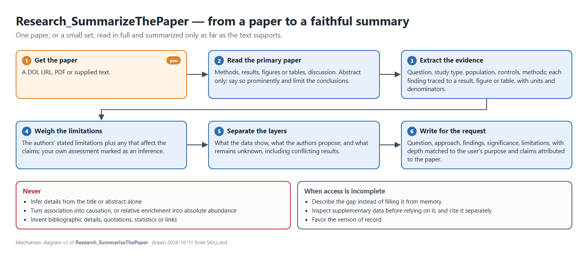

# Research paper reading

<!-- skill-diagram:begin (Repo_SkillAutomaticCommitPush New-SkillDiagram.ps1 rewrites this block) -->

*Mechanism diagram v1* - page: [Research_SummarizeThePaper_mechanism_v1.html](Skill_Diagram/v1/Research_SummarizeThePaper_mechanism_v1.html).
<!-- skill-diagram:end -->

Read the primary paper before summarizing it. Open the full text when available, including methods, results, figures or tables needed for the user's question, and discussion. If only an abstract is accessible, say so prominently and limit the conclusions to what it supports. Do not infer details from the title or abstract alone.

## Extract the evidence

- Identify the research question, study type, system or population, comparison or controls, and primary methods. Distinguish experiments, observational analyses, modeling, and reviews.
- Trace each important finding to a result, figure, or table. Record quantitative effects, sample sizes, uncertainty, and statistical tests when central to the claim. Preserve units and denominators. Do not turn relative enrichment into absolute abundance, association into causation, or localization into demonstrated function.
- Read the authors' stated limitations and identify any additional limitation that directly affects the claims being summarized. Mark your own assessment as an inference.
- Separate what the data show, what the authors propose, and what remains unknown. Mention conflicting or negative results when they change the interpretation.

## Write for the request

Default to a concise explanation with the paper's question, approach, principal findings, significance, and limitations. Define specialized terms briefly. Adjust depth and format to the user's purpose; a request about one mechanism may call for a focused explanation rather than a general template.

Link to the primary paper and cite specific sections or figures when useful. Attribute claims to the paper. If supplementary data or another study is needed for a claim, inspect it before relying on it and cite it separately. Avoid invented bibliographic details, quotations, statistics, and source links.

When access is incomplete or a result cannot be verified, describe the gap instead of filling it from memory. For a paper with multiple versions, favor the version of record and note material differences if they matter.
